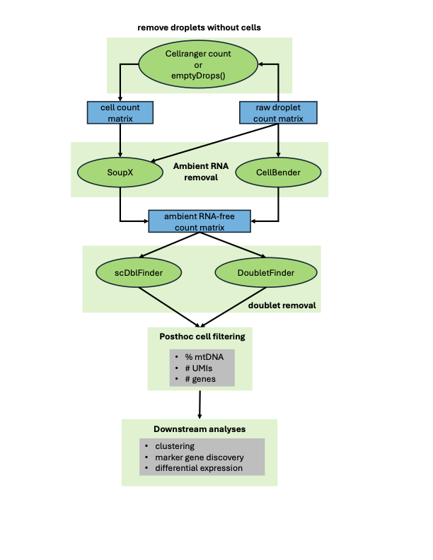

# scRNAseq-preprocessing
Documentation of and code for analyses performed to assess the effect of different methods for cleanup and pre-processing of raw scRNAseq data on downtream analyses.

## Goals
The primary objective of our methods assessment is to evaluate the sensitivity of downstream analyses of scRNA-seq data such as clustering, marker gene discovery and differential expression analysis across samples to the preprocessing and data cleanup steps that are employed to generated a filtered expression matrix. A broad overview of the options we evaluate are summarized in this schematic:


<p align="center">
    
</p>

## How to use

### Input data

The workflow starts from the per-sample count-matrix outputs produced by [10x Genomics Cell Ranger `count`](https://www.10xgenomics.com/support/software/cell-ranger). For each sample you supply a data directory laid out like a Cell Ranger `count` result, containing:

- `filtered_feature_bc_matrix/` — with `barcodes.tsv.gz`, `features.tsv.gz`, and `matrix.mtx.gz`
- `raw_feature_bc_matrix/` — with `barcodes.tsv.gz`, `features.tsv.gz`, and `matrix.mtx.gz`
- `raw_feature_bc_matrix.h5`

Both the filtered and the raw (unfiltered) matrices are required: the raw matrix drives the ambient-RNA removal (SoupX, CellBender) and empty-droplet (emptyDrops) steps. Any tool that emits matrices in this Cell Ranger–style layout can be used, not only Cell Ranger itself. Point each sample at the directory that *directly* contains the three entries above (in a Cell Ranger run, that is the sample's `outs/` directory).

### Sample sheet

Samples are declared in a **tab-separated** sample sheet with two required columns and one optional column, one row per sample:

| Column | Description |
|--------|-------------|
| `sampleid` | Unique identifier for the sample; used to name that sample's output files. |
| `tenx_datadir` | Path to the sample's Cell Ranger–style data directory (absolute, or relative to the working directory). |
| `mt_genes` | Optional. Path to a plain-text file of the sample's mitochondrial gene IDs, one per line (absolute, or relative to the working directory). Leave it blank, or leave the column out, to find mitochondrial genes by name. See [Mitochondrial genes and regression](#mitochondrial-genes-and-regression). |

For example (`samplesheet.tsv`):

```
sampleid	tenx_datadir
neuron_10k_v3	/data/neuron_10k_v3/outs
L8TX_181211_01_G12	/data/L8TX_181211_01_G12/outs
```

Tell the workflow where the sample sheet is with the `sampleTable` key in `config/config.yaml` (default `samplesheet.tsv`), or override it on the command line with `--config sampleTable=/path/to/samplesheet.tsv`. The sample sheet is validated before the run starts: missing columns, blank or duplicate `sampleid` values, `tenx_datadir` paths that do not exist or are missing any of the required matrices above, and `mt_genes` files that do not exist, list no gene ID or name none of the sample's features all fail fast with an explanatory error.

### Running the workflow

Edit `config/config.yaml` to set `sampleTable`, the desired `workflow_mode` (see [Workflow modes](#workflow-modes)), and the preprocessing options, then run Snakemake against `workflow/Snakefile`. A minimal local run:

```
snakemake \
    --snakefile workflow/Snakefile \
    --configfile config/config.yaml \
    --use-conda \
    --cores 8
```

`--use-conda` is required: every R rule runs in one pinned conda environment, `workflow/envs/scrnaseq_r.yml` (built from its lock file `scrnaseq_r.linux-64.pin.txt`), so all methods share the same R and package versions; CellBender runs in its digest-pinned container. Any config value can be overridden without editing the file, e.g. `--config workflow_mode=preprocess sampleTable=samplesheet.tsv`.

On an HPC cluster, add a Snakemake profile so jobs are submitted to the scheduler instead of run locally — for example `--workflow-profile profiles/slurm --profile cannon` for the bundled SLURM / Harvard Cannon profiles. See `scrnaseq_preprocess_slurmrunner.sh` for a complete SLURM submission example.

### CellBender cell calls without background removal

CellBender calls cells and removes ambient RNA in one model, so the `cellbender_fromraw` objects carry the effects of both. With `cellbender_cell_calls: true` (requires `cellbender_fromraw`), the workflow also subsets the raw matrix to the barcodes CellBender called as cells (those in its `*_filtered.h5`), keeping their raw counts (`results/cellbendercells/{sample}_cellbendercells_filtered_matrix/`), and builds that matrix with the CellRanger rule's own script into `results/cellbendercells/filtered_seurat_cellbendercells_{sample}.rds`. Its markers and downsampling stability follow as for every other object. It compares directly with the CellRanger (`seurat_filtered/filtered_seurat_tenx_{sample}`) and emptyDrops (`emptydrops/filtered_seurat_emptydrops_{sample}`) cell-calling objects, and is not carried into decontamination, doublet removal or post-hoc filtering.

### Mitochondrial genes and regression

Every Seurat object carries `percent.mt`, the percentage of a cell's counts that come from mitochondrial genes, as cell metadata. No cell is filtered on it. Two options set how its genes are found and whether it, or another cell variable, is regressed out:

- **Which genes are mitochondrial (`mt_genes`, per sample).** By default `percent.mt` counts the genes whose names (column 2 of `features.tsv.gz`) start with `mt-` in any case, the pattern `"(?i)^mt-"`. Many annotations name their mitochondrial genes otherwise (`ND1`, `COX1`, ...) or give them no recognisable name, and then `percent.mt` is 0 in every cell. For such a sample, list its mitochondrial gene IDs in a file, one per line, and give the file's path in the sample sheet's `mt_genes` column. The IDs are matched against column 1 of the sample's `features.tsv.gz` (with Cell Ranger, the reference GTF's `gene_id`); blank lines and lines starting with `#` are ignored. Listed IDs that are not features are reported and skipped, and a list that names none of the sample's features stops the run. Samples without a list keep the pattern.
- **What is regressed out (`vars_to_regress`, in `config/config.yaml`).** The cell metadata columns that every `SCTransform` call regresses out of its residuals, as Seurat's `vars.to.regress`: any of `percent.mt`, `nCount_RNA` and `nFeature_RNA`. The default, `[]`, regresses nothing. It applies to every step that runs `SCTransform`, each downsampling replicate included; DoubletFinder's own internal `SCTransform` runs are not affected. A `percent.mt` that is regressed out is computed, in every step, on the cells' RNA counts (the counts `SCTransform` models), from the sample's list or the pattern. With `percent.mt` in the list, every sample needs at least one mitochondrial feature, by the pattern or its list: a sample with none stops the run before any job starts, and its jobs fail if they run anyway.

For example, to regress out `percent.mt` in a run that mixes a mouse sample, whose mitochondrial genes the pattern finds, with a rice sample, whose mitochondrial genes are listed by ID:

```
sampleid	tenx_datadir	mt_genes
neuron_10k_v3	/data/neuron_10k_v3/outs
sc_108	/data/osativa_sc108/outs	mt_genes/osativa_mt_gene_ids.txt
```

```yaml
vars_to_regress: ["percent.mt"]
```

A list is mapped to the row names of each object that is built from the sample's features (the CellRanger, emptyDrops, CellBender, SoupX and decontX steps), and the object records the names in `misc$percent_mt_features`. The doublet-removal, post-hoc filtering and downsampling steps start from such an object and use the names it records. Changing a sample's list, or `vars_to_regress`, makes Snakemake rerun the steps that use it.

## Workflow modes

The main Snakemake entrypoint supports three `workflow_mode` values in `config/config.yaml` or via `--config`:

- `preprocess`: run the preprocessing workflow only. This is the default and preserves the original behavior.
- `preprocess_and_downsample`: run preprocessing and then downsample the generated Seurat `.rds` outputs with `workflow/rules/downsample_clusters.smk`.
- `downsample_only`: skip preprocessing and run downsampling on existing Seurat `.rds` files from `downsampleSeuratObjectDir`.

Downsampling outputs are written to `downsampleResultsDir`, defaulting to `results/downsampling`. Use `downsampleTargets` to restrict downsampling to selected Seurat object basenames, or leave it as `all` to use every available input for the selected mode.

## Scalability notes

Most rules scale roughly linearly in cell count (dominated by the `SCTransform` working set), and per-rule memory requests in `workflow/rules/*.smk` are sized accordingly. One exception matters for large datasets:

- **DoubletFinder memory grows as O(N²).** `doubletfinder` augments the full dataset with ~25% synthetic doublets and builds a dense pairwise distance matrix over all cells: roughly 78 GB at 77k cells, 132 GB at 100k, 298 GB at 150k, and 530 GB at 200k. This is inherent to the algorithm and cannot be tuned away. For large inputs (roughly >100k cells — e.g. emptyDrops cell calls, which are often much larger than the CellRanger filtered set) prefer **scDblFinder** via the `doublet_removal_methods` config, as it does not materialize a full distance matrix and scales far better.

## Tests
For information on how to run the test suite, or run the workflow in test mode, see tests/README.md.
